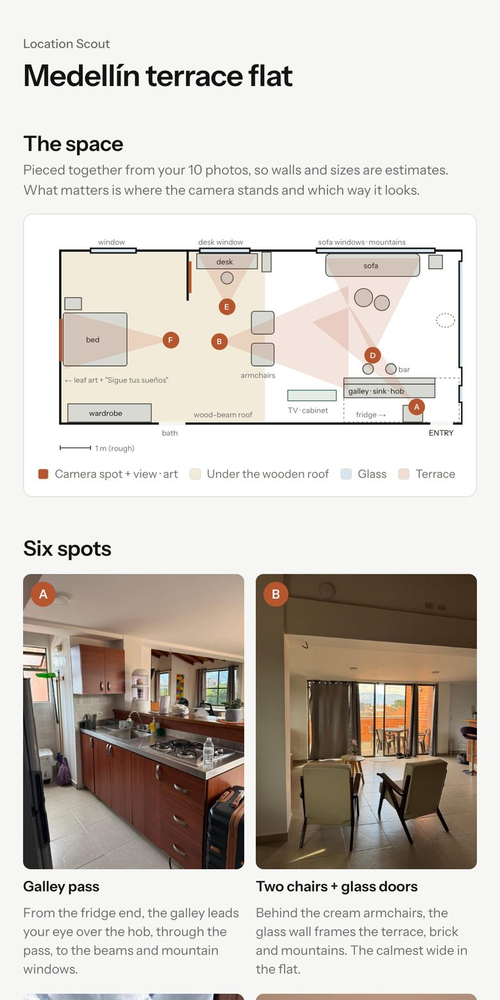
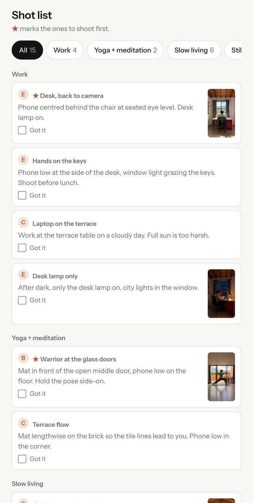
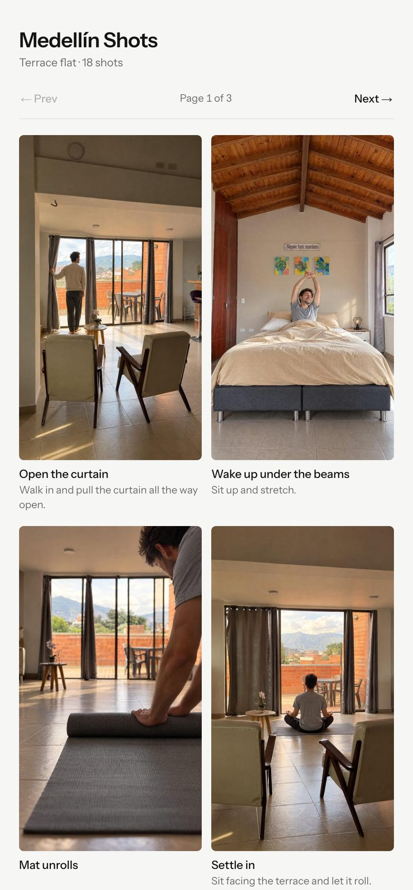

# Location Scout

Check into an Airbnb, send Claude 6–10 photos, and get back a shot plan for **that** place, plus AI previews of you filming in it.

Made for creators who film slow-living, work and yoga content in a new place every few weeks and don't want to think about where to put the camera.

| Scout page | Shot list | Shots grid |
|---|---|---|
|  |  |  |

*Example: a terrace flat in Medellín. Open [`example/medellin-terrace/scout.html`](example/medellin-terrace/scout.html) and [`shots.html`](example/medellin-terrace/shots.html) after downloading.*

## What you get

- **Scout page**
  - Floor plan with numbered camera spots and where each one looks
  - 4–6 spots (A–F), each with a photo
  - A morning routine you can shoot as one sequence (swipe through it)
  - Shot list in four buckets: Work · Yoga + meditation · Slow living · Stills, ★ the ones to shoot first, tick them off as you go
  - A 5-minute reset checklist (what to move out of frame) and light notes (where the sun is when)
- **AI previews** (Higgsfield): your stand-in character in the real room, one per shot
- **Shots grid**: up to 18 previews, 6 per page, title + one line. Open it on your phone and copy the frames.

## Setup

1. **Connect Higgsfield in Claude** (strongly recommended)
   - Claude → Settings → Connectors → Higgsfield → sign in
   - Why: the previews are the point. Seeing yourself in each frame, in the actual room, is what makes filming take zero thinking.
   - Without it you still get the scout page, but the grid uses your plain room photos.
2. **Download**: green **Code** button → **Download ZIP** → unzip → drag the `location-scout` folder into Claude.
3. **Make it you**: open `character.md` and rewrite the description to look like you (age, build, hair, outfit).
4. **Go**: drop your check-in photos into the chat and say *"Here are my check-in photos."*

Claude checks Higgsfield and your credits first, shows the cost, and asks before generating anything.

## Photo tips

- Take them **before you unpack**.
- One wide from the door, then one from **each corner** at 0.5×.
- One of anything high up: loft, stairs, balcony, rooftop.
- The view, the bed, the desk, any art you like.
- Say which way the windows face, or when the sun comes in.

## Cost

- ~**2.75 credits** per preview (GPT Image 2.5, high quality, 2k, 9:16)
- ~**50 credits** for a full set of 18
- Claude shows the estimate and your balance before it starts.

## Repo layout

```
CLAUDE.md          instructions Claude follows
character.md       your stand-in character
templates/         the two page designs
scripts/           build.py (place.json → both pages), resize.py
example/           Medellín, finished
places/            your scouts go here (not tracked by git)
```

Build a place by hand: `python3 scripts/build.py places/<slug>` (Python 3 + Pillow).

## License

MIT
